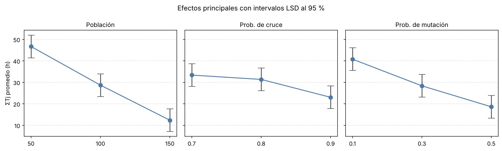

# Fase 2 — Calibración de los parámetros del algoritmo genético

Script: `fase2/calibracion_ag.py` · Resultados: `fase2/salida_calibracion/`

## 1. Propósito

El desempeño de un algoritmo genético depende de sus parámetros. Si se fijan
"a ojo", el jurado puede preguntar por qué esos valores y no otros. La calibración
responde con un diseño de experimentos: se prueban combinaciones de parámetros
sobre la instancia real y se elige la mejor con un análisis estadístico (Ruiz,
Maroto y Alcaraz, 2006; Montgomery, 2017).

## 2. Diseño del experimento

### 2.1 Experimento 1: diseño factorial completo 3³

| Factor | Niveles |
|---|---|
| Tamaño de la población | 50, 100, 150 |
| Probabilidad de cruce | 0,7; 0,8; 0,9 |
| Probabilidad de mutación | 0,1; 0,3; 0,5 |

- **27 combinaciones × 5 réplicas = 135 corridas** sobre la instancia real
  (10 órdenes, B̄ = 10, 100 sublotes). La configuración que trae hoy el código
  (150; 0,9; 0,5) es uno de los puntos del diseño, así que queda comparada
  directamente.
- **Parámetros fijos:** torneo de tamaño 3, probabilidad de intercambio en la
  secuencia 0,30, probabilidad de perturbar los tamaños 0,40, desviación de la
  perturbación 0,15, elitismo de un individuo y población inicial sembrada con la
  mejor regla de despacho.
- **Mismo presupuesto de cómputo por corrida:** 30.000 individuos generados
  (población × generaciones): 600 generaciones con población 50, 300 con 100 y
  200 con 150. Si el criterio fuera "generaciones sin mejora", una población
  grande usaría más evaluaciones y la comparación sería injusta.
- **Números aleatorios comunes:** la réplica r usa la misma semilla (1000 + r) en
  las 27 combinaciones. Las diferencias entre combinaciones se deben a los
  parámetros y no al azar de la semilla.

### 2.2 Variable de respuesta

- **Respuesta principal:** la tardanza total ΣT_j (h) de la mejor solución de la
  corrida, que es el objetivo del modelo.
- **Respuesta secundaria:** desviación porcentual relativa del makespan,
  RPD = 100·(C_max − C_max*)/C_max*, con C_max* el mejor makespan entre las
  corridas que lograron la mejor tardanza.
- **Pruebas de rangos** (Kruskal-Wallis, Wilcoxon): se aplican sobre
  Z = 1000·ΣT_j + C_max. Como solo usan el orden de los datos, ordenar por Z
  equivale a ordenar según el objetivo lexicográfico (primero ΣT_j, luego C_max).

### 2.3 Análisis estadístico

1. ANOVA multifactorial con efectos principales e interacciones dobles.
2. Gráfico de medias con intervalos LSD al 95 %: si los intervalos de dos niveles
   no se traslapan, la diferencia es significativa.
3. Supuestos: normalidad de residuos (Shapiro-Wilk) y homogeneidad de varianzas
   (Levene). Si no se cumplen, la conclusión se apoya en Kruskal-Wallis.
4. Comparación pareada por semilla (Wilcoxon) entre la mejor combinación y la
   configuración actual.

### 2.4 Experimento 1b: ampliación del rango

Si la mejor combinación queda en el borde del rango probado, el óptimo podría
estar más allá. Por eso se prueban, con las mismas semillas y presupuesto,
población 150, 200 y 250 con mutación 0,5 y 0,7. El cruce se fija en 0,9 porque
no resultó significativo. La configuración solo se cambia si la mejora frente a
la actual es significativa (Wilcoxon, α = 0,05); si no, se conserva la actual por
parsimonia.

### 2.5 Experimento 2: criterio de parada

Con la mejor combinación se compara la parada por 50, 100 y 200 generaciones sin
mejora (máximo 1.000 generaciones), con 10 réplicas cada una. Se miden la calidad
(RPD, ΣT_j, C_max) y el tiempo. Así se elige el criterio de parada del modelo
final según la relación entre calidad y tiempo.

## 3. Resultados

Informe completo generado por el script: `fase2/salida_calibracion/informe_calibracion.md`.
Datos de cada corrida: `corridas_diseno.csv`, `corridas_ampliacion.csv` y
`corridas_parada.csv`.

### 3.1 Experimento 1: diseño factorial (135 corridas)

Mejores y peores combinaciones. La tabla completa de las 27 está en
`resumen_combinaciones.csv` y en el informe.

| Población | P. cruce | P. mutación | ΣT_j prom (h) | ΣT_j desv | % réplicas con ΣT_j = 0 | C_max prom (h) | RPD C_max (%) | Tiempo (s) |
|---|---|---|---|---|---|---|---|---|
| **150** | **0,9** | **0,5** | **0,00** | **0,00** | **100** | **652,3** | **3,7** | **95** |
| 150 | 0,8 | 0,5 | 0,37 | 0,84 | 80 | 656,1 | 4,3 | 98 |
| 100 | 0,9 | 0,3 | 1,82 | 4,07 | 80 | 651,6 | 3,6 | 89 |
| 150 | 0,9 | 0,3 | 5,04 | 11,28 | 80 | 671,3 | 6,8 | 92 |
| 150 | 0,8 | 0,3 | 5,56 | 7,32 | 40 | 664,4 | 5,6 | 88 |
| … | … | … | … | … | … | … | … | … |
| 50 | 0,9 | 0,3 | 59,57 | 20,36 | 0 | 731,6 | 16,3 | 90 |
| 50 | 0,7 | 0,1 | 61,83 | 37,51 | 0 | 733,8 | 16,7 | 71 |
| 50 | 0,8 | 0,1 | 73,48 | 22,35 | 0 | 745,5 | 18,5 | 79 |

La configuración que ya traía el código (150; 0,9; 0,5) es la mejor de las 27:
es la única que eliminó la tardanza en las 5 réplicas.

**ANOVA sobre ΣT_j** (efectos principales e interacciones dobles; coincide con
`statsmodels`):

| Fuente | SC | gl | CM | F | valor p |
|---|---|---|---|---|---|
| Población | 26.514,5 | 2 | 13.257,3 | 20,65 | < 0,001 |
| Prob. de cruce | 2.702,8 | 2 | 1.351,4 | 2,10 | 0,127 |
| Prob. de mutación | 11.110,5 | 2 | 5.555,2 | 8,65 | < 0,001 |
| Población × cruce | 4.076,3 | 4 | 1.019,1 | 1,59 | 0,182 |
| Población × mutación | 2.254,8 | 4 | 563,7 | 0,88 | 0,480 |
| Cruce × mutación | 688,1 | 4 | 172,0 | 0,27 | 0,898 |
| Error | 74.484,3 | 116 | 642,1 | | |
| Total | 121.831,3 | 134 | | | |

**Supuestos.**

- Los residuos son normales: Shapiro-Wilk W = 0,990, p = 0,459.
- Las varianzas no son homogéneas entre niveles de población (Levene p < 0,001)
  ni de mutación (p = 0,029).
- Por eso la conclusión se confirma con Kruskal-Wallis, que coincide con el ANOVA:
  - población: H = 30,2, p < 0,001;
  - mutación: H = 14,5, p < 0,001;
  - cruce: H = 4,5, p = 0,106.



- Aumentar la población (50 → 150) y la mutación (0,1 → 0,5) reduce la tardanza
  de forma significativa: los intervalos LSD de sus niveles no se traslapan.
- La probabilidad de cruce no tiene efecto significativo en el rango 0,7–0,9.
- Ninguna interacción es significativa, así que cada parámetro se puede elegir
  por separado.

### 3.2 Experimento 1b: ampliación del rango (25 corridas nuevas)

La mejor combinación quedó en el borde (población y mutación máximas), así que
se probaron niveles más allá:

| Población | P. mutación | ΣT_j prom (h) | % réplicas con ΣT_j = 0 | C_max prom (h) | Wilcoxon vs. actual (p) |
|---|---|---|---|---|---|
| **150** | **0,5** | **0,00** | **100** | **652,3** | — |
| 200 | 0,5 | 0,00 | 100 | 656,6 | 0,813 |
| 150 | 0,7 | 0,16 | 80 | 664,0 | 0,125 |
| 250 | 0,5 | 2,00 | 80 | 665,1 | 0,438 |
| 200 | 0,7 | 2,99 | 20 | 672,1 | 0,063 |
| 250 | 0,7 | 8,67 | 0 | 680,7 | 0,063 |

(Kruskal-Wallis entre las seis: H = 17,1, p = 0,004.)

Más allá del borde, el desempeño se mantiene (población 200) o empeora
(población 250 o mutación 0,7). Con presupuesto fijo, una población mayor tiene
menos generaciones para evolucionar, y una mutación mayor destruye buenas
soluciones. El óptimo está dentro del rango probado. Como población 200 no es
significativamente distinta de 150, **se conserva 150** (parsimonia: menor
población, mismo resultado).

### 3.3 Experimento 2: criterio de parada (30 corridas)

Configuración (150; 0,9; 0,5), máximo de 1.000 generaciones:

| Generaciones sin mejora | ΣT_j prom (h) | % réplicas con ΣT_j = 0 | C_max prom (h) | RPD C_max (%) | Generaciones prom | Tiempo prom |
|---|---|---|---|---|---|---|
| 50 | 0,00 | 100 | 650,8 | 4,47 | 388 | 3,1 min |
| **100** | **0,00** | **100** | **644,5** | **3,45** | **633** | **5,0 min** |
| 200 | 0,00 | 100 | 642,7 | 3,18 | 855 | 6,6 min |

- Con la configuración calibrada, las 30 corridas eliminaron la tardanza; la
  diferencia está en el C_max.
- Pasar de 50 a 100 generaciones sin mejora reduce el C_max de forma
  significativa (Wilcoxon pareado p = 0,016; sigue siendo significativo con la
  corrección de Bonferroni por dos comparaciones, α = 0,025).
- Pasar de 100 a 200 no mejora de forma significativa (p = 0,063) y aumenta el
  tiempo en un 33 %.
- La prueba global de Kruskal-Wallis (p = 0,21) no detecta diferencias porque no
  aprovecha el emparejamiento por semilla.

### 3.4 Configuración final del algoritmo genético

| Parámetro | Valor | Origen |
|---|---|---|
| Tamaño de la población | 150 | Calibrado (exp. 1 y 1b) |
| Probabilidad de cruce | 0,9 | Calibrado (sin efecto significativo; se toma el de menor ΣT_j) |
| Probabilidad de mutación | 0,5 | Calibrado (exp. 1 y 1b) |
| Criterio de parada | 100 generaciones sin mejora (máx. 1.000) | Calibrado (exp. 2) |
| Torneo, prob. de intercambio, prob. de perturbación, desviación | 3; 0,30; 0,40; 0,15 | Fijos (valores del código) |

**Cambio sugerido en el código:** en `GA_PARAMS`, pasar `'sin_mejora': 50` a
`'sin_mejora': 100`. Los demás valores ya coinciden con la calibración.

**Alcance.** La calibración se hizo sobre la instancia real (10 órdenes,
B̄ = 10) con 5 réplicas por combinación. Si la Fase 3 cambia el número de
sublotes u otras condiciones de forma importante, conviene repetir al menos el
experimento 2 (es corto) para confirmar el criterio de parada.

## 4. Texto sugerido para el documento

> Los parámetros del algoritmo genético se calibraron mediante un diseño
> factorial completo 3³ sobre la instancia real: tamaño de población (50, 100,
> 150), probabilidad de cruce (0,7; 0,8; 0,9) y probabilidad de mutación
> (0,1; 0,3; 0,5), con 5 réplicas por combinación (135 corridas). Todas las
> corridas tuvieron el mismo presupuesto de 30.000 individuos generados y las
> mismas semillas en cada réplica. El ANOVA sobre la tardanza total mostró
> efectos significativos del tamaño de población (F = 20,65; p < 0,001) y de la
> probabilidad de mutación (F = 8,65; p < 0,001), sin efecto significativo de la
> probabilidad de cruce (p = 0,127) ni de las interacciones. Como no se cumplió
> la homogeneidad de varianzas, el resultado se confirmó con la prueba de
> Kruskal-Wallis. La mejor combinación (población 150, cruce 0,9, mutación 0,5)
> eliminó la tardanza en todas sus réplicas. Al estar en el borde del rango
> probado, se evaluaron poblaciones de 200 y 250 y una mutación de 0,7, sin
> obtener mejoras significativas, por lo que se conservó la combinación
> original. Por último, se comparó el criterio de parada: 100 generaciones sin
> mejora redujeron significativamente el makespan frente a 50 (prueba de
> Wilcoxon, p = 0,016), mientras que 200 no aportaron una mejora significativa
> y aumentaron el tiempo de cómputo en un 33 %.

## 5. Cómo reproducirlo

```bash
pip install pandas openpyxl matplotlib scipy
cd fase2
# Experimento 1 (≈ 45 min con 4 núcleos; ≈ 3 h con 1)
python calibracion_ag.py diseno ruta/final_sc_hfsagls_S2_4.py ruta/BD_HFS.xlsx
# Experimento 2 (usa la mejor combinación del experimento 1, o --config 100,0.8,0.3)
python calibracion_ag.py parada ruta/final_sc_hfsagls_S2_4.py ruta/BD_HFS.xlsx
# Solo volver a generar el informe y las figuras
python calibracion_ag.py analizar
```

- Cada corrida se guarda en `corridas_diseno.csv` / `corridas_parada.csv` en
  cuanto termina. Si la sesión se corta (por ejemplo en Colab), al ejecutar el
  mismo comando se continúa con las corridas que faltan.
- `--procesos N` define cuántas corridas van en paralelo (por defecto, todos los
  núcleos). `--replicas` y `--presupuesto` cambian el tamaño del experimento.
- `--prueba` hace una corrida corta de verificación en otra carpeta.
- Factores, niveles y parámetros del experimento se cambian al inicio del archivo
  (`FACTORES`, `REPLICAS`, `PRESUPUESTO`, `PARADA_NIVELES`).
